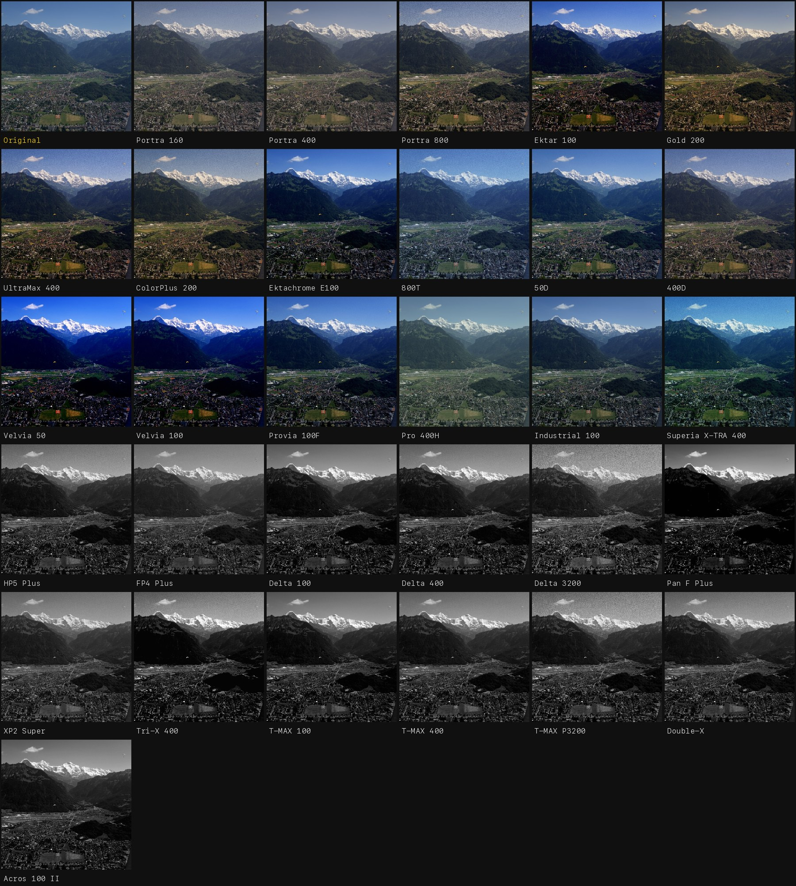

# GlassMeter Film Looks

The film simulations from [GlassMeter](https://glass-works.ai), a medium-format
light meter and film camera for iPhone, made reusable: 30 film stocks as open
data, a drop-in Swift package for iOS apps, `.cube` LUTs for most editors, and
Lightroom / Camera Raw profiles.



**Color negative:** Portra 160 / 400 / 800, Ektar 100, Gold 200, UltraMax 400, ColorPlus 200, Pro 400H, Industrial 100, Superia X-TRA 400, CineStill 800T / 50D / 400D
**Slide:** Ektachrome E100, Velvia 50 / 100, Provia 100F
**Black & white:** HP5 Plus, FP4 Plus, Delta 100 / 400 / 3200, Pan F Plus, XP2 Super, Tri-X 400, T-MAX 100 / 400 / P3200, Double-X, Acros 100 II

## Use it

| You want to… | Use |
|---|---|
| **Add film looks to an iOS app** (or have an AI agent do it) | Give your agent [`AGENT_GUIDE.md`](AGENT_GUIDE.md). It covers the Swift package, the full math for other pipelines, and test vectors. |
| **Edit in Lightroom Classic / Lightroom / Camera Raw** | [`lightroom/profiles`](lightroom/profiles), installed as below |
| **Edit in Photoshop, Capture One, Resolve, Final Cut, Affinity…** | [`luts/cube-srgb-33`](luts/cube-srgb-33) (33³ `.cube`, sRGB) |
| **Read or port the data** | [`profiles/film-stocks.json`](profiles/film-stocks.json) |

The [Releases](../../releases) page has the Lightroom profiles and the LUTs as
two zip downloads.

### Lightroom and Camera Raw profiles

- **Lightroom Classic:** Develop → Profile Browser (the four-squares icon next to *Profile*) → **+** → *Import Profiles…* → select the `.xmp` files or the zip.
- **Lightroom (desktop):** Edit → Profile → *Browse* → **⋯** → *Import Profiles…*. Profiles then sync to Lightroom on iPhone and iPad.
- **Photoshop Camera Raw:** Profile Browser → **⋯** → *Import Profiles…*.

They appear under **GlassMeter Film**. The *Amount* slider runs 0–200 %. A
profile doesn't touch your sliders, so you can layer exposure and white
balance on top.

Grain and halation depend on image size, so a LUT or profile can't hold them.
Add them with Lightroom's own Grain panel. The Swift package renders both.

### LUTs

33³ `.cube` files, sRGB in and out, for a normally exposed, display-referred
image. In Photoshop: *Layer → New Adjustment Layer → Color Lookup → 3DLUT File → Load 3D LUT…*.

### Swift package

```swift
.package(url: "https://github.com/TrondW/glassmeter-film-looks", branch: "main")
```

```swift
import GlassFilmLooks

let film = FilmProfileLibrary.bundled.film(id: "kodak-portra-400")!
let output = FilmLookRenderer().apply(film, to: ciImage)   // grain + halation included
```

iOS 15+ / macOS 12+, Core Image only, no other dependencies. See
[`AGENT_GUIDE.md`](AGENT_GUIDE.md) for the details.

## Credit (the only condition)

Everything here is licensed [CC BY 4.0](LICENSE): use it, change it, ship it
in free or paid apps. The one condition is credit. In an app's credits or
acknowledgements, write:

> **Film simulations from GlassMeter by Glass Works (glass-works.ai)**

For presets you share or sell, mention it in the description.

## How it works

Each look is an original curve set authored for GlassMeter: a channel mixer for
crosstalk, per-channel tone curves, saturation, print contrast, an optional
push/pull curve, and a characteristic curve (toe, midtone slope, shoulder)
taken from each film's published H&D curve character. Grain is
luminance-weighted (strongest in the midtones), and halation is a red bloom
whose strength is a property of the film. CineStill, without its anti-halation
layer, always halates. The full math is in [`AGENT_GUIDE.md`](AGENT_GUIDE.md) §4.

`tools/reference/film_look.py` is an independent, dependency-free Python
implementation. It produces `profiles/test-vectors.json`, and the Swift
package's tests check against those vectors.

## Regenerate

```bash
swift test                                              # package vs test vectors
swift run -c release glassfilm cubes luts/cube-srgb-33  # .cube files
swift run -c release glassfilm lightroom lightroom/profiles
swift run -c release glassfilm render photo.jpg out/    # every look, grain + halation
python3 tools/reference/film_look.py vectors            # rewrite test vectors
tools/export-profiles/export.sh /path/to/GlassMeter     # re-export from the app source
```

## Trademarks

Kodak, Portra, Ektar, Ektachrome, T-MAX, Tri-X, Fujifilm, Velvia, Provia,
Acros, Superia, Ilford, HP5, FP4, Delta, Pan F, XP2 and CineStill are
trademarks of their respective owners. These looks are original
interpretations made for GlassMeter. They are not affiliated with or endorsed
by those companies, and are not derived from their LUTs or anyone else's.
